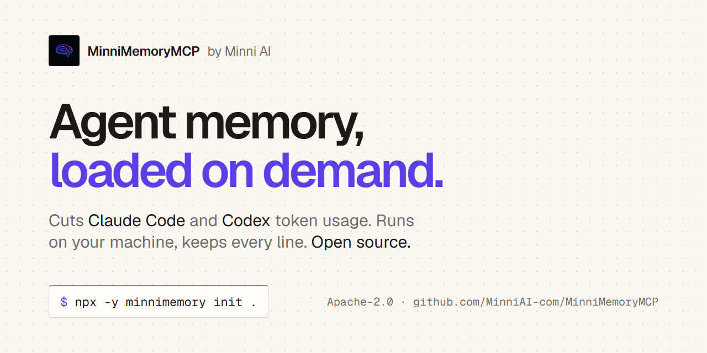

# Minni AI

Minni Labs is a research and development company working in the optimization space for AI
agents, in both software and hardware. In software, we work in the memory layer of AI agents:
MinniMemoryMCP applies our memory interface to coding agents, and in our latest test it cut a
Claude Code session's cost by 31%, with the answers holding up. Other runs saved less, and one
cost more; every number we publish has a row in our research ledger, with how it was measured.
In hardware, we are building MinniTuner's AI Workstation tier to get the most out of a machine's
CPU, GPU and RAM for running models locally.

## MinniMemoryMCP is open source

**Reduce your coding agent's token usage.** MinniMemoryMCP splits your agent's memory into a
small core that loads every turn and files that load only when a task needs them. No lines
lost. Works in Claude Code and Codex, runs on your computer, no model, no key, nothing sent
over the internet.

- **Measured:** $0.83 to $0.57 for the same 30 questions in Claude Code, 31% less in our best
  run and about 16% less in the median of 13. [Every run is in the ledger.](https://github.com/MinniAI-com/MinniMemoryMCP/blob/main/vendor/ledger/RESULTS.md)
- **Try it:** `npx -y minnimemory init .` shows the plan and the diff before anything changes;
  `undo` puts the originals back.
- **Source:** [MinniAI-com/MinniMemoryMCP](https://github.com/MinniAI-com/MinniMemoryMCP),
  Apache-2.0. Issues and pull requests welcome, starting with the `good first issue` label.

[Source](https://github.com/MinniAI-com/MinniMemoryMCP) ·
[npm](https://www.npmjs.com/package/minnimemory) ·
[Docs](https://minniai.com/minnimemorymcp/docs) ·
[Claude Code plugin](https://github.com/MinniAI-com/minnimemory-plugin) ·
[Measured results](https://minniai.com/evidence)

## Products

| | What it does | Get it |
|---|---|---|
| **MinniMemoryMCP** | Splits your agent's memory into a small always-on part and files that load only when a task needs them. Open source. | [Source](https://github.com/MinniAI-com/MinniMemoryMCP) · [minniai.com/minnimemorymcp](https://minniai.com/minnimemorymcp) |
| **MinniCode** | A low token terminal coding agent, optimized for open LLMs. Reads, edits, tests and opens pull requests. | [minniai.com/minnicode](https://minniai.com/minnicode) · [docs](https://minniai.com/minnicode/docs) |
| **MinniTuner** | Tell it what feels slow. It reads your PC, proposes a plan, applies with undo. | [minniai.com/minnituner](https://minniai.com/minnituner) |

## Learn

- [How to reduce Claude Code token usage](https://minniai.com/learn/reduce-claude-code-token-usage)
- [How to reduce Codex token usage](https://minniai.com/learn/reduce-codex-token-usage)
- [Claude Code usage limit reached: what to do](https://minniai.com/learn/claude-code-usage-limit-reached)
- [Codex usage limits: why they drain](https://minniai.com/learn/codex-usage-limits)
- [AGENTS.md too large: what Codex cuts off](https://minniai.com/learn/agents-md-too-large)
- [Why Claude Code sessions get expensive](https://minniai.com/learn/why-claude-code-sessions-get-expensive)
- [CLAUDE.md vs MinniMemoryMCP](https://minniai.com/learn/claude-code-memory-claude-md-vs-minnimemorymcp)

[minniai.com](https://minniai.com) · [YouTube](https://www.youtube.com/@MinniLabs) ·
[Book a call](https://minniai.com/#contact) · AI agents: start at [minniai.com/agents.md](https://minniai.com/agents.md)
